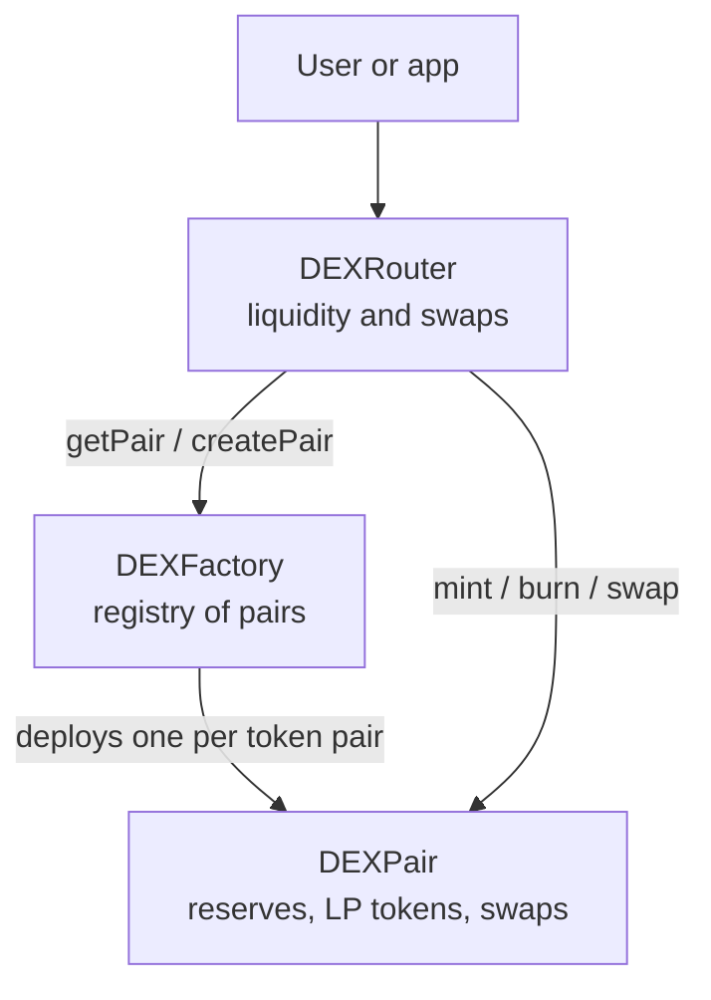
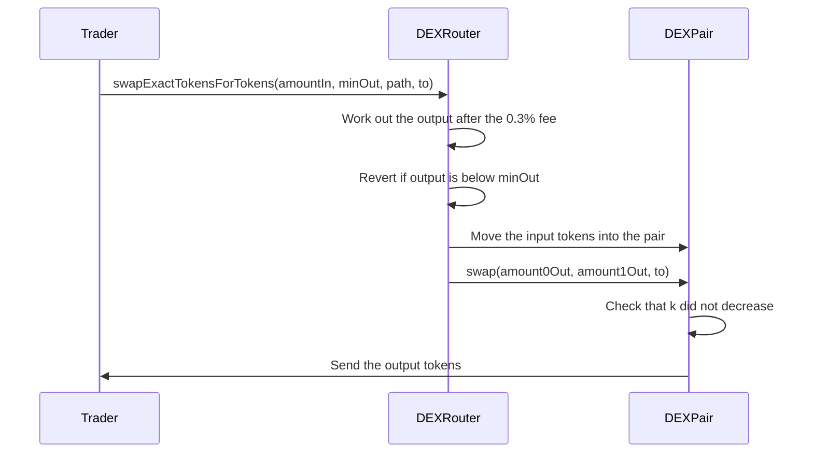

# DEX AMM: A Uniswap V2-Style Decentralized Exchange


**A set of Ethereum smart contracts that let people swap ERC-20 tokens directly with each other, with no order book and no middleman.**

Instead of matching buyers with sellers, this exchange uses **liquidity pools**: shared piles of two tokens that anyone can trade against. A simple formula sets the price based on how much of each token is in the pool. People who deposit tokens into a pool (liquidity providers) earn a share of a 0.3% fee on every swap.

The design follows Uniswap V2 and is split into three contracts:

- **`DEXFactory`** creates and keeps a registry of trading pairs.
- **`DEXPair`** is one pool for one pair of tokens. It holds the reserves, mints LP tokens, and executes swaps.
- **`DEXRouter`** is the friendly front door: add or remove liquidity, swap tokens, and route a trade through several pools.

> **Status:** this is a learning and portfolio project. It has **not been audited**. Use it on a local network or a testnet only, never with real funds.

<details>
<summary><b>New to DeFi? Key terms in plain English</b></summary>

- **DEX (decentralized exchange):** a trading app made of smart contracts instead of a company.
- **ERC-20:** the standard for fungible tokens (tokens that are all identical, like currencies).
- **AMM (automated market maker):** software that sets prices with a formula instead of an order book.
- **Liquidity pool:** a contract holding reserves of two tokens that traders swap against.
- **LP token:** a receipt you get for depositing into a pool. You burn it to get your share back.
- **Slippage:** the gap between the price you expected and the price you actually got. You set a limit so a trade fails rather than fill at a bad price.
- **Path:** the list of tokens a trade passes through, for example A → B → C.
- **Price:** in a pool, the price of one token is the reserve of the other token divided by its own reserve.

</details>

---

## Technologies

- **Solidity 0.8.28** with the optimizer on (200 runs)
- **Hardhat 3** for compiling, testing, and deploying
- **OpenZeppelin Contracts 5.x**: `ERC20`, `ReentrancyGuard`, `Math`
- **ethers.js 6** for the tests and the deploy script
- **Mocha + Chai** for the test suite
- **TypeScript** for the Hardhat configuration

---

## Features

**Liquidity pools**
- Create a pool for any two ERC-20 tokens (one pool per pair, enforced by the factory)
- The first deposit sets the starting price
- Deposit both tokens and receive LP tokens; burn them any time to withdraw your share
- The first 1,000 units of LP tokens are permanently locked, which protects against a known price-manipulation trick on empty pools
- The router creates a missing pool automatically when you add liquidity

**Swaps**
- Swap an exact amount in (`swapExactTokensForTokens`) or ask for an exact amount out (`swapTokensForExactTokens`)
- Multi-hop routing through several pools, for example A → B → C
- A 0.3% fee on every swap, which stays in the pool and grows the liquidity providers' share
- Slippage limits on every swap and every liquidity deposit
- Read-only price functions: `getAmountsOut`, `getAmountsIn`, `quote`

**Safety and quality**
- Reentrancy guards on every state-changing function in the pair and the router
- A check after every swap that the pool's "k" value did not decrease
- Events for every important action (`PairCreated`, `Mint`, `Burn`, `Swap`, `Sync`, `LiquidityAdded`, `LiquidityRemoved`, `TokensSwapped`)
- 23 test cases covering the factory, liquidity, swaps, multi-hop swaps, and price impact
- A mintable `ERC20Token` for testing (anyone can mint, so it is for local use only)

---

## What Users Can Do

| Who | What they can do |
|-----|------------------|
| **Liquidity provider** | Approve the router, deposit two tokens into a pool, and receive LP tokens. Later, return the LP tokens to get the tokens back, including the fees earned. |
| **Trader** | Approve the router, then swap one token for another, either directly or through several pools. |
| **Developer / integrator** | Read prices and reserves with `getAmountsOut`, `getReserves`, and `getPair` before sending a transaction. |
| **Anyone** | Call `sync` on a pool to refresh its reserves, or `skim` to pull out any tokens that were sent to a pool by mistake. |

<details>
<summary><b>Code examples (ethers v6)</b></summary>

**Add liquidity**

```js
const routerAddress = await router.getAddress();

// The router must be allowed to move your tokens
await tokenA.approve(routerAddress, ethers.parseEther("100"));
await tokenB.approve(routerAddress, ethers.parseEther("100"));

await router.addLiquidity(
  await tokenA.getAddress(),
  await tokenB.getAddress(),
  ethers.parseEther("100"),  // amountADesired
  ethers.parseEther("100"),  // amountBDesired
  ethers.parseEther("95"),   // amountAMin (allows 5% slippage)
  ethers.parseEther("95"),   // amountBMin
  user.address               // who receives the LP tokens
);
```

**Swap tokens (with a 0.5% slippage limit)**

```js
const path = [await tokenA.getAddress(), await tokenB.getAddress()];
const amountIn = ethers.parseEther("10");

await tokenA.approve(routerAddress, amountIn);

const amounts = await router.getAmountsOut(amountIn, path);
const minOut = (amounts[1] * 995n) / 1000n;

await router.swapExactTokensForTokens(amountIn, minOut, path, user.address);
```

**Multi-hop swap (A → B → C):** use a three-token path, `[tokenA, tokenB, tokenC]`, and read the final amount from `amounts[2]`.

**Remove liquidity**

```js
const pairAddress = await factory.getPair(tokenAAddress, tokenBAddress);
const lpToken = await ethers.getContractAt("DEXPair", pairAddress);
const liquidity = await lpToken.balanceOf(user.address);

await lpToken.approve(routerAddress, liquidity);
await router.removeLiquidity(tokenAAddress, tokenBAddress, liquidity, 0, 0, user.address);
```

</details>

---

## Keyboard Shortcuts

Not applicable. This project is smart contracts and has no keyboard-driven interface. The terminal commands you will use most are listed in [How to Run](#how-to-run).

---

## The Process

**How the three contracts fit together**



**What happens during a swap**



**The price formula**

Each pool keeps the product of its two reserves constant: `x * y = k`. When a trader adds tokens to one side, the pool gives back just enough of the other side to keep that product from shrinking. This is why large trades move the price more than small ones.

With the 0.3% fee, the output is:

```
amountOut = (amountIn * 997 * reserveOut) / (reserveIn * 1000 + amountIn * 997)
```

**Worked example**

A pool holds 1,000 A and 2,000 B (so k = 2,000,000). A trader swaps 100 A:

- Fee-adjusted input: 100 × 0.997 = 99.7 A
- Output: (99.7 × 2,000) / (1,000 + 99.7) ≈ **181.32 B**
- New reserves: 1,100 A and about 1,818.68 B
- New k: about 2,000,546, which is higher than before because the fee stays in the pool

<details>
<summary><b>Good to know: price impact, slippage, and impermanent loss</b></summary>

- **Price impact** grows with trade size. Before fees, a trade worth 1% of the input reserve moves the price by about 1%, 10% by about 9%, and 50% by about 33%.
- **Slippage limits** (`amountOutMin`, `amountInMax`) make a trade revert if the price moves against you between sending and execution.
- **Impermanent loss:** liquidity providers can end up with less value than if they had simply held the tokens when prices move. For example, deposit 1 ETH and 2,000 USDC, and if ETH doubles to 4,000 USDC, the pool position is worth about $5,657 versus $6,000 for holding, a loss of about 5.7%. Fees can offset this.

</details>

---

## How I Built It

I followed the Uniswap V2 design, which splits the work across three contracts so each one stays small and focused. The contracts build on OpenZeppelin's token and security libraries instead of reinventing them.

Design decisions worth knowing:

- **The router sends tokens first, the pair measures what arrived.** The pair does not pull tokens in. It compares its balance with its saved reserves to see how much was deposited, then does the math.
- **A "k" safety check on every swap.** After sending the output, the pair confirms that the fee-adjusted product of its balances did not drop. If it did, the whole swap reverts.
- **Fees stay in the pool.** The 0.3% is never paid out separately. It simply makes the reserves grow, so LP tokens are worth more over time.
- **Locked minimum liquidity.** The first provider receives `sqrt(amount0 * amount1) - 1000` LP tokens, and 1,000 units are sent to `address(1)` forever.
- **Integer maths only.** Solidity has no decimals, so the fee is written as 997/1000 and rounding is handled carefully (`getAmountIn` rounds up by one so the pool is never short).
- **Reentrancy protection.** OpenZeppelin's `ReentrancyGuard` protects every state-changing function in the pair and the router.
- **Open maintenance functions.** `skim` and `sync` can be called by anyone, as in Uniswap V2. Tokens sent to a pool by mistake can be taken by whoever calls `skim` first.

<details>
<summary><b>Project structure</b></summary>

```
dex-amm/
├── contracts/
│   ├── DEXFactory.sol    # Creates pairs and keeps the registry
│   ├── DEXPair.sol       # The pool: reserves, LP tokens, swaps, price math
│   ├── DEXRouter.sol     # User-facing: liquidity, swaps, multi-hop routing
│   └── ERC20Token.sol    # Test token (anyone can mint)
├── scripts/
│   └── deploy.js         # Deploys everything and sets up two sample pools
├── test/
│   └── DEX.test.js       # 23 test cases
├── hardhat.config.ts     # Compiler settings
├── TECHNICAL.md          # Deeper technical walkthrough
└── package.json
```

</details>

<details>
<summary><b>Function reference</b></summary>

**DEXFactory**

| Function | What it does |
|----------|--------------|
| `createPair(tokenA, tokenB)` | Deploys a new pair (reverts if tokens are identical, zero, or the pair exists) |
| `getPair(tokenA, tokenB)` | Returns the pair address (works in either token order) |
| `allPairs(index)` / `allPairsLength()` | Lists every pair created |

**DEXRouter**

| Function | What it does |
|----------|--------------|
| `addLiquidity(...)` | Deposits both tokens at the right ratio and mints LP tokens (creates the pair if needed) |
| `removeLiquidity(...)` | Burns LP tokens and returns both tokens |
| `swapExactTokensForTokens(...)` | Swaps an exact input amount along a path |
| `swapTokensForExactTokens(...)` | Swaps whatever input is needed to get an exact output amount |
| `getAmountsOut(...)` / `getAmountsIn(...)` | Previews amounts along a path |
| `quote(...)` | Works out the matching amount of the other token at the current ratio |

**DEXPair**

| Function | What it does |
|----------|--------------|
| `mint(to)` / `burn(to)` | Low-level liquidity functions, normally called by the router |
| `swap(amount0Out, amount1Out, to)` | Low-level swap, normally called by the router |
| `getReserves()` | Returns the two reserves |
| `getAmountOut(...)` / `getAmountIn(...)` / `quote(...)` | Pure price calculations |
| `skim(to)` / `sync()` | Maintenance functions for tokens sent in by mistake |

</details>

For more depth, see [TECHNICAL.md](TECHNICAL.md).

---

## What I Learned

> Edit these so they sound like you. They are based on how the project is built.

- **How an AMM prices trades.** The constant-product formula replaces an order book, and fees quietly increase `k`.
- **Why the first deposit is special.** The first provider sets the price, and locking a small amount of LP tokens stops the pool from being manipulated when it is nearly empty.
- **Router versus pair.** Keeping the risky low-level logic in the pair and the user-friendly checks (slippage, ratios) in the router made each part easier to reason about.
- **Integer maths in Solidity.** Fees, rounding direction, and overflow all need deliberate handling when there are no decimals.
- **Reentrancy and invariants.** A guard plus an "after the swap, k must not drop" check is a simple, powerful safety pattern.
- **Being honest about limits.** Writing down what the contracts do not do (see below) is part of building secure software.

---

## How It Could Be Improved

These are known limits of the current version.

- **Add a transaction deadline.** The router has no deadline parameter, so a transaction that sits pending can execute later at a worse price.
- **Support ETH.** Only ERC-20 to ERC-20 trading works. Adding wrapped ETH (WETH) support would allow ETH pools.
- **Support fee-on-transfer tokens.** The router calculates amounts before the transfer, so tokens that take a fee on transfer make swaps revert.
- **Use `SafeERC20`.** Token transfers do not check return values, so some non-standard tokens would not work or could fail silently.
- **Add a price oracle.** Pools do not record cumulative prices (TWAP), so on-chain prices can be manipulated and should not be used as a price feed by other contracts.
- **Add route finding.** The caller must supply the path. A helper (off-chain or in a library) could search for the best route.
- **Make pair addresses predictable.** Deploying pairs with `CREATE2` would let apps compute a pair's address without calling the factory.
- **Test more.** Add tests for how fees are shared between several liquidity providers, plus fuzz and invariant tests, a coverage report, and static analysis (for example Slither).
- **Build a frontend.** A React app using ethers.js or wagmi would make the exchange usable without scripts.
- **Get an independent audit** before anything touches real funds.

---

## How to Run

**Prerequisites**
- Node.js **22.10 or higher** (required by Hardhat 3)
- npm (comes with Node.js)

```bash
node -v
npm -v
```

**1. Clone the repository**

```bash
git clone https://github.com/DesaiSakshi1/dex-amm.git
cd dex-amm
```

**2. Install dependencies**

```bash
npm install
```

**3. Compile the contracts**

```bash
npx hardhat compile
```

**4. Run the tests**

```bash
npx hardhat test
```

**5. Deploy to the local Hardhat network**

```bash
npx hardhat run scripts/deploy.js
```

The deploy script sets up a ready-to-use demo: it deploys the factory and router, creates three test tokens (TKA, TKB, TKC), opens two pools (TKA/TKB and TKB/TKC) with 10,000 of each token, previews a sample swap, and saves every address to `deployment-info.json`.

**6. Deploy to a testnet (for example Sepolia)**

Add a network entry to `hardhat.config.ts` with an RPC URL and your account key, then run:

```bash
npx hardhat run scripts/deploy.js --network sepolia
```

Keep your private key and RPC URL in environment variables or a `.env` file that is listed in `.gitignore`. Never commit them. Do not deploy this project to mainnet.

---

## Demo Video

[](YOUR_VIDEO_URL)

_A short walkthrough: running the tests, deploying locally, and doing a swap and a multi-hop swap against the sample pools._

---

## License

Released under the MIT License.
